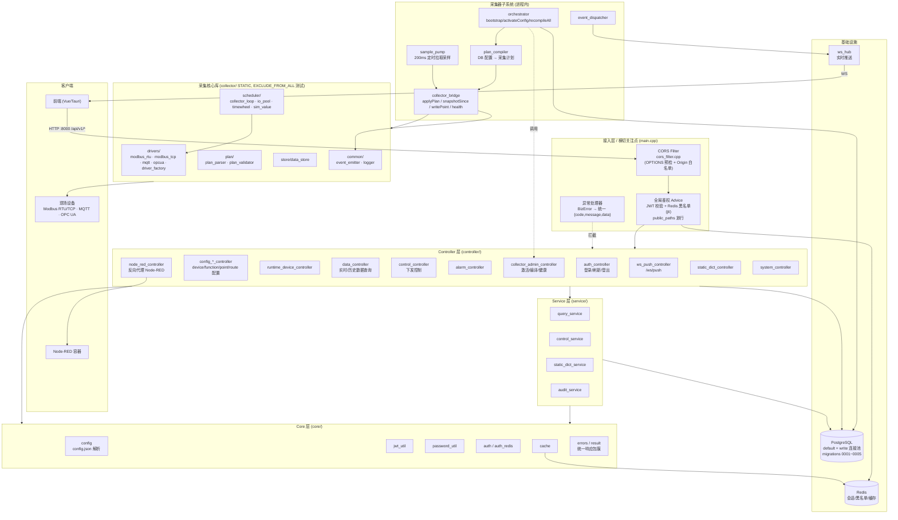
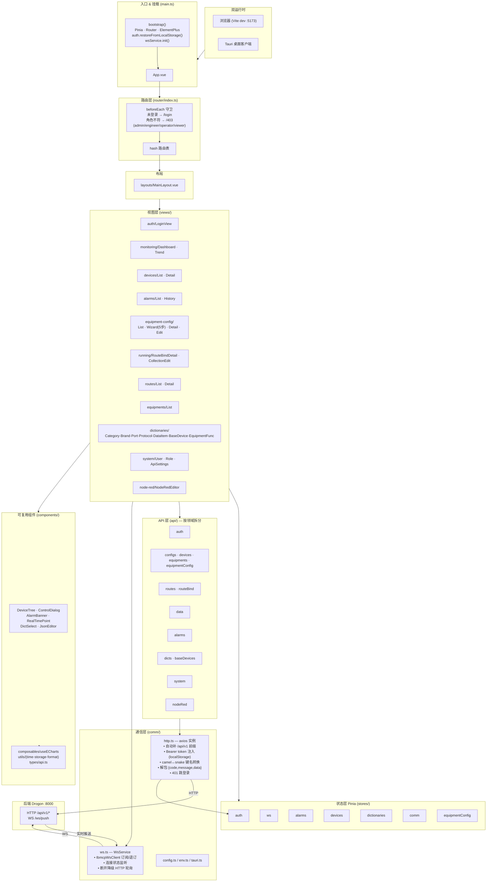

# 13 - 前后端架构图

> 本文以代码为准，给出后端（Drogon / C++）与前端（Vue 3 + TS + Vite + Tauri）的分层架构图，以及前后端交互契约。信息来源：`backend/src/main.cpp`、`backend/include/`、`backend/collector/`、`frontend/src/router/index.ts`、`frontend/src/main.ts`、`frontend/src/comm/http.ts` 等。

## 1. 后端架构图（Drogon / C++）

### 后端要点

- 单进程内分层清晰：**接入 Advice → Controller → Service → Core/DB/Collector**。
- 采集器是**编译进主进程的静态库**，由 `orchestrator` 编排、`collector_bridge` 桥接；`sample_pump` 以 `sample_pump_interval_ms`（默认 200ms）周期拉取采样写入 DB；`event_dispatcher` 把事件推给 `ws_hub` 再广播前端。
- 鉴权在 `main.cpp` 用 `registerPostRoutingAdvice` 统一拦截（`backend/src/main.cpp:54`），JWT 载荷存到 request attribute 供 controller 读取，登出靠 Redis 黑名单（jti）实现。
- 免鉴权白名单由 `config.json` 的 `custom_config.public_paths` 定义（共 7 项：login、refresh、ping、redis/ping、openapi.json、docs、redoc）。

## 2. 前端架构图（Vue 3 + TS + Vite + Tauri）

### 前端要点

- 通信层做了**统一契约适配**：`http.ts` 自动补 `/api/v1` 前缀、注入 Bearer token、做 `snake_case↔camelCase` 键名转换、解包后端的 `{code,message,data}` 包膜（`frontend/src/comm/http.ts:16` 至 `:99`），让视图层拿到干净的对象。
- **双运行时**：同一份代码既跑浏览器也跑 Tauri 桌面（通过 `comm/env.ts` 检测运行时），Tauri 仅影响 baseURL 等环境配置。
- 路由守卫在 `frontend/src/router/index.ts:171`，按 4 种角色（admin/engineer/operator/viewer）做前端级权限控制；实时数据走 WebSocket，断开时 `ws.ts` 自动降级为 HTTP 轮询兜底。

## 3. 前后端交互契约

| 通道 | 前端 | 后端 | 说明 |
|------|------|------|------|
| HTTP | `comm/http.ts`（axios，baseURL=`CommConfig.apiBase`） | Drogon 监听 `0.0.0.0:8000`（`backend/config.json:4`） | 所有路径自动补 `/api/v1` 前缀 |
| 响应格式 | 拦截器解包 `{code,message,data}` | `core/result` 统一包膜；`/openapi.json` `/docs` `/redoc` 除外 | `code=0/200` 视为成功 |
| 鉴权 | `localStorage` 存 `ibmc_token`，请求头注入 `Bearer` | `main.cpp` post-routing advice 校验 JWT + Redis 黑名单（jti） | `public_paths` 共 7 项免鉴权 |
| WebSocket | `comm/ws.ts` → `IbmcpWsClient`，按 topic 订阅/退订 | `ws_push_controller` `/ws/push` + `ws_hub` 广播 | 实时采样/报警推送，断开降级轮询 |
| 采集上报 | 前端不直连 | `/api/v1/ws/collect`（`backend/src/main.cpp:59` 放行） | 采集器侧通道 |
| Node-RED | `views/node-red/NodeRedEditor.vue` | `node_red_controller` 反向代理 | 流编辑器嵌入前端 |

## 4. 与其他文档的关系

- 整体设计决策与进程/线程模型见 [01-Drogon 架构设计](./01-Drogon架构设计.md)；
- Controller → 端点的完整映射见 [03-接口契约与 Controller 映射](./03-接口契约与Controller映射.md)；
- 采集器融合与调度细节见 [04-采集器融合与调度](./04-采集器融合与调度.md)；
- Redis 缓存 / 黑名单 / 推送实现见 [09-Redis 缓存与实时推送](./09-Redis缓存与实时推送.md)；
- 全项目技术栈与依赖全景见 [10-全项目技术栈与部署指南](./10-全项目技术栈与部署指南.md)。